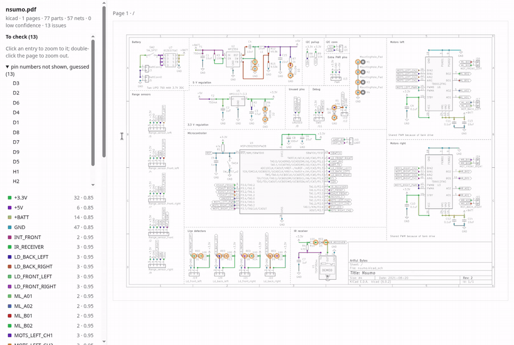

<p align="center"></p>

Recover electrical connectivity from vector schematic PDFs. schem2net reads PDF
paths, text and drawing order to reconstruct components, physical pins and nets.
It writes JSON, KiCad netlists and editable schematics, BOMs, SPICE and an HTML
review report.

The problem is more than recognizing symbols: crossing wires may not connect,
labels can join distant sheets, and a nearby number may identify the wrong pad.
The extractor combines geometry, generator conventions and learned classifiers;
it does not perform OCR on scanned schematics.

This is experimental software. Check the drawing and reported issues before
using an extracted netlist to design or build hardware.

## Demo



The report highlights an extracted net, then zooms to a guessed-pad warning in the
[nsumo controller by Artful Bytes](https://github.com/artfulbytes/nsumo_hardware/tree/4ed17819480d61c4b71980c695a0770774c9d91b)
([MIT notice](docs/media/NOTICE)). [Run the same example locally](#install-and-run).
Verify extracted connections and pad numbers against the PDF.

## Install and run

Requires Python 3.11 or later. Install from the repository with
[uv](https://docs.astral.sh/uv/):

```sh
uv tool install git+https://github.com/rzadevv/schem2net
```

Download the pinned [nsumo controller schematic by Artful Bytes](https://raw.githubusercontent.com/artfulbytes/nsumo_hardware/4ed17819480d61c4b71980c695a0770774c9d91b/imgs/schematic.pdf)
as `nsumo.pdf`, then run:

```sh
schem2net extract nsumo.pdf -o nsumo.ir.json
schem2net export nsumo.ir.json --to kicad-net -o nsumo.net
schem2net report nsumo.pdf -o nsumo.html
```

These commands were checked against that PDF: extraction finds 77 components
and 57 nets, with 13 issues to review. This is a usage example, not an additional
accuracy benchmark. The JSON preserves pin provenance, net confidence and issues;
the HTML report places them over the original drawing. Footprints must be assigned
before PCB work. Unresolved numbered identities require particular care.

## Supported inputs and workflows

| Generator | Reading |
|---|---|
| KiCad | Vector exports, hierarchical sheets, buses and multi-unit parts. |
| Altium | Carried Smart PDF netlists when present; otherwise drawing reconstruction. |
| Eagle | Stroke-font and outlined text, including print-to-fit exports. |
| EasyEDA | Std and Pro PDF exports; support remains uneven. |
| OrCAD Capture | Vector PDFs produced through a PDF printer, in colour or black. |

Scanned pages are skipped. Custom fonts, hidden pins, nonstandard pad numbering,
fragmented symbols and references confused with values remain difficult. Unknown
export styles may be read using a guessed profile and flagged for review.

Net confidence is an evidence weight, not a probability of correctness. A
high-confidence net may still have a wrong pad; inspect pin-level issues too.
Files over 1,000 pages are refused. Object and page-time guards are cooperative,
not hard process isolation; see [usage and limits](docs/usage.md).

Additional commands include `schematic` for an editable KiCad project, `diff` for
revision comparisons, and `index-library` for optional pin recovery. The
[usage guide](docs/usage.md) covers exports, regions, libraries, Python access and
read-only MCP tools.

An optional desktop application, `schem2net-gui`, opens a PDF, runs extraction
and shows the report beside lists of nets, components and issues. Install it with
the `gui` extra; see [Desktop application](docs/usage.md#desktop-application).

## Evaluation

The frozen extractor at `5d2417c` was evaluated once on **63 new designs from 40
source groups**: 62 generated KiCad PDFs and one native Altium PDF, with 16,341
connected truth pins. Drawing-only pin accuracy was **91.02%** (95% source-group
bootstrap interval 88.14–93.66%); **1.10%** of scored truth pins were silently wrong.
These figures do not establish equal support across all five generators.

The candidate did not meet its release criteria: silent-error non-inferiority
remained inconclusive, a high-confidence MCU pad error was confirmed, and generator
coverage was incomplete. [Full results and protocol](docs/release-2026-11-05.md)
include missing pins, extras, unsupported references, review quality and failures.
[Benchmark methodology](docs/benchmark.md) separates this panel from historical
test/holdout results and the repeatedly optimized development corpus.

## Development

```sh
git clone https://github.com/rzadevv/schem2net.git
cd schem2net
make install
make test
make lint
make package-check
```

See [architecture](docs/pipeline.md) for the extraction stages and algorithms, and
[development](docs/development.md) for tests, benchmark reproduction and the
archived engineering comparisons. The runtime dependencies are NumPy, SciPy,
PDFium, Pydantic and Typer. Scikit-learn is needed for model training, not inference;
MCP is optional for users.

## License and distribution status

Project source is under [Apache-2.0](LICENSE). The five bundled learned assets
predate this cleanup and remain unchanged. Their exact training provenance,
source notices and font-shape permissions still need review; see the
[asset inventory](docs/learned-assets.md). This repository is not an approved
production release. Package publication is disabled pending that review.
